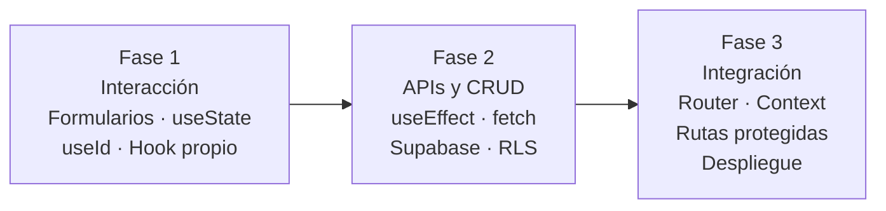

# Plan de Implementación — FitPlan · Corte 3

> [!NOTE] Basado en las guías de clase `Clase_C3_03`, `Clase_C3_04` y `Clase_C3_05` del proyecto Desarrollo Web EAM 2026-II.

---

## Fase 1 · Interacción y Formularios
**Clase C3-03 — Tercer encuentro del corte 3**

### Objetivo
Construir una interfaz que responda a las acciones del usuario: eventos, estado local, formularios controlados y filtros en memoria.

---

### Paso 1.1 — Interacción con estado y contenido condicional

| Qué hacer | Dónde aplicarlo en FitPlan |
|---|---|
| Declarar `useState` para almacenar una decisión del usuario | Componente `Encabezado` (menú abierto/cerrado ya funciona) |
| Renderizado condicional según el estado | Mostrar/ocultar secciones, alertas o detalles de rutina |
| Usar función actualizadora cuando el nuevo valor depende del anterior | Contadores, toggles, agregar registros a un arreglo |

> [!TIP] Los valores calculables (ej. cantidad de rutinas filtradas) **no necesitan estado propio** — se calculan durante el renderizado a partir del estado existente.

---

### Paso 1.2 — Formulario controlado con validación

| Qué construir | Reglas mínimas |
|---|---|
| Al menos **2 campos controlados** con `value` + `onChange` | Peso y altura ya están en `CalculadoraIMC` ✅ |
| Cancelar el envío tradicional con `e.preventDefault()` | ✅ ya implementado |
| Validar antes de continuar: texto vacío, rangos, tipos | Mostrar mensaje de causa y permitir corrección |
| Usar `useId` para relacionar `<label>` y `<input>` | Evita IDs duplicados cuando el formulario aparece dos veces |

**Archivos a crear/modificar:**
- `src/componentes/CalculadoraIMC.jsx` — reforzar validación con mensajes claros
- Nuevo formulario en `SeccionProgreso` para registrar una sesión desde la UI

---

### Paso 1.3 — Registros en memoria + búsqueda/filtro

| Qué construir | Detalles |
|---|---|
| Agregar registros al estado (arreglo) | El formulario de progreso añade a `useState([])` |
| Filtro o búsqueda con estado compartido | El componente padre administra el criterio y lo pasa como prop |
| Mensaje de estado vacío | Distinguir "cargando", "sin resultados" y "lista vacía inicial" |

**Flujo de estado sugerido:**

```
SeccionProgreso (estado: registros[], filtro)
    ├── CabeceraProgreso (props: total, completadas)
    ├── FormularioProgreso (recibe: onAgregar)
    └── ListaFiltrada (props: registros, filtro)
            └── TarjetaProgreso × n (props: rutina, fecha, estado, nota...)
```

---

### Paso 1.4 — Hook personalizado

| Hook | Responsabilidad |
|---|---|
| `useToggle(inicial)` | Alterna un booleano; usado en `Encabezado` y paneles colapsables |
| `useFiltro(lista)` | Encapsula criterio + lista filtrada + función de cambio |

> [!IMPORTANT] Cada llamada a un Hook personalizado conserva su **propio estado**. Reutilizar `useToggle` en dos paneles los hace independientes entre sí.

**Entregable de la Fase 1:** Interacción funcional en React con commit en GitHub. Probar envíos inválidos/válidos, registros consecutivos y búsquedas sin coincidencias.

---

## Fase 2 · APIs y CRUD con Supabase
**Clase C3-04 — Cuarto encuentro del corte 3**

### Objetivo
Conectar la interfaz React con datos externos: leer desde Supabase, completar el ciclo CRUD y manejar correctamente los estados de la petición.

---

### Paso 2.1 — Separar vista, Hook y servicio

```
src/
├── servicios/
│   └── progresoService.js    ← conoce la URL, parámetros y formato de Supabase
├── hooks/
│   └── useProgreso.js        ← coordina consulta, dependencias, limpieza y estados
└── componentes/
    └── SeccionProgreso.jsx   ← solo presenta datos y recibe acciones
```

| Capa | Responsabilidad |
|---|---|
| `progresoService.js` | `obtener()`, `crear()`, `editar(id)`, `eliminar(id)` — llama a `fetch` / Supabase JS |
| `useProgreso.js` | `useEffect` con dependencias, limpieza con `AbortController`, estados `cargando/error/datos` |
| Componente | Muestra lo que recibe; no conoce la URL |

---

### Paso 2.2 — Lectura con `useEffect`

```js
// Esquema de useProgreso.js
function useProgreso(filtro) {
  const [datos, setDatos] = useState([])
  const [cargando, setCargando] = useState(true)
  const [error, setError] = useState(null)

  useEffect(() => {
    const controller = new AbortController()
    setCargando(true)
    setError(null)

    progresoService.obtener(filtro, controller.signal)
      .then(setDatos)
      .catch(err => { if (err.name !== 'AbortError') setError(err.message) })
      .finally(() => setCargando(false))

    return () => controller.abort()   // limpieza: cancela si cambia filtro o se desmonta
  }, [filtro])

  return { datos, cargando, error }
}
```

> [!WARNING] **No mostrar el mensaje "sin resultados" mientras `cargando` sea `true`** — una lista vacía inicial no significa que la búsqueda terminó.

---

### Paso 2.3 — Los cuatro estados de la consulta en la UI

| Estado | Qué mostrar |
|---|---|
| `cargando: true` | Spinner o texto "Cargando…" |
| `error: mensaje` | Descripción del problema + botón "Reintentar" |
| `datos: []` | "No tienes sesiones registradas aún" |
| `datos: [...]` | Lista de `TarjetaProgreso` |

---

### Paso 2.4 — CRUD completo

| Operación | Detalles clave |
|---|---|
| **Crear** | Validar antes de enviar; bloquear el botón mientras espera; usar el registro que devuelve la API (con su `id` real) |
| **Leer** | `useEffect` con dependencias; cancelar lecturas anteriores con `AbortController` |
| **Editar** | Conservar el `id` estable aunque la lista se filtre; confirmar lo que devolvió el servicio |
| **Eliminar** | Pedir confirmación; retirar el registro del estado local tras la respuesta exitosa |

> [!IMPORTANT] **La clave pública de Supabase no reemplaza la sesión ni las políticas RLS.** Configurar Row Level Security en la tabla `progreso`.

**Entregable de la Fase 2:** CRUD funcional en React conectado a Supabase. Incluir prueba de creación, consulta, edición, eliminación y recarga de página.

---

## Fase 3 · Navegación e Integración Final
**Clase C3-05 — Quinto encuentro del corte 3**

### Objetivo
Organizar las vistas con React Router, compartir la sesión con Context y dejar el proyecto publicado y verificado.

---

### Paso 3.1 — Rutas con React Router

**Instalar:** `npm install react-router-dom`

```
src/
├── rutas/
│   └── RutaProtegida.jsx     ← redirige a /acceso si no hay sesión
├── paginas/
│   ├── Inicio.jsx
│   ├── Rutinas.jsx
│   ├── Progreso.jsx          ← vista privada con CRUD
│   ├── Acceso.jsx            ← login con Google (Supabase Auth)
│   └── NoEncontrado.jsx      ← ruta 404
└── App.jsx                   ← define <Routes>
```

**Estructura de rutas:**

| Patrón | Vista | Protegida |
|---|---|---|
| `/` | `Inicio` | No |
| `/rutinas` | `Rutinas` | No |
| `/progreso` | `Progreso` | ✅ Sí |
| `/acceso` | `Acceso` | No |
| `*` | `NoEncontrado` | No |

---

### Paso 3.2 — Context para la sesión

```
src/contexto/SesionContext.jsx
```

```jsx
// SesionContext.jsx — esquema
const SesionContext = createContext(null)

export function SesionProvider({ children }) {
  const [sesion, setSesion] = useState(undefined)  // undefined = comprobando

  useEffect(() => {
    supabase.auth.getSession().then(({ data }) => setSesion(data.session))
    const { data: listener } = supabase.auth.onAuthStateChange((_ev, s) => setSesion(s))
    return () => listener.subscription.unsubscribe()
  }, [])

  return <SesionContext.Provider value={sesion}>{children}</SesionContext.Provider>
}

export const useSesion = () => useContext(SesionContext)
```

> [!IMPORTANT] La sesión tiene **tres estados**: `undefined` (comprobando), `null` (no autenticado), `objeto` (autenticado). Tratar `undefined` como `null` provoca redirecciones prematuras.

---

### Paso 3.3 — Ruta protegida

```jsx
// RutaProtegida.jsx
function RutaProtegida({ children }) {
  const sesion = useSesion()
  if (sesion === undefined) return <p>Verificando sesión…</p>
  if (!sesion) return <Navigate to="/acceso" replace />
  return children
}
```

---

### Paso 3.4 — Menú activo y accesibilidad

- Usar `<NavLink>` de React Router (aplica clase `active` automáticamente)
- Combinar color con señal visual (subrayado ya definido en `.site-header nav a[aria-current="page"]`)
- Conservar indicador de foco (`:focus-visible` ya está en `styles.css` ✅)

---

### Paso 3.5 — Verificaciones antes de la sustentación

```
Checklist de entrega final
```

- [ ] Acceso directo a `/progreso` recarga correctamente (el hosting sirve `index.html`)
- [ ] Al cerrar sesión, las vistas privadas dejan de estar disponibles
- [ ] Una cuenta no puede ver ni editar datos de otra (verificar con 2 cuentas)
- [ ] `localStorage` limpia datos de usuario al cerrar sesión
- [ ] Variables de entorno en `.env` y `.env` en `.gitignore` — sin secretos en el repo
- [ ] `README.md` con instrucciones para configurar sin publicar secretos
- [ ] URL pública desplegada (Vercel / Netlify / GitHub Pages + SPA redirect)
- [ ] Bitácora C3-05 completa con commit, evidencias y defensa técnica

---

## Resumen de fases



| Fase | Clase | Temas clave | Entregable |
|---|---|---|---|
| **1 · Interacción** | C3-03 | `useState`, eventos, `FormData`, campos controlados, `useId`, filtros, Hooks propios | Interacción funcional en React con commit |
| **2 · APIs** | C3-04 | `useEffect`, dependencias, limpieza, `fetch`, estados de carga, CRUD Supabase | CRUD funcional con prueba completa |
| **3 · Integración** | C3-05 | React Router, Context, sesión, rutas protegidas, CSS Modules, despliegue | App pública + README + bitácora final |
